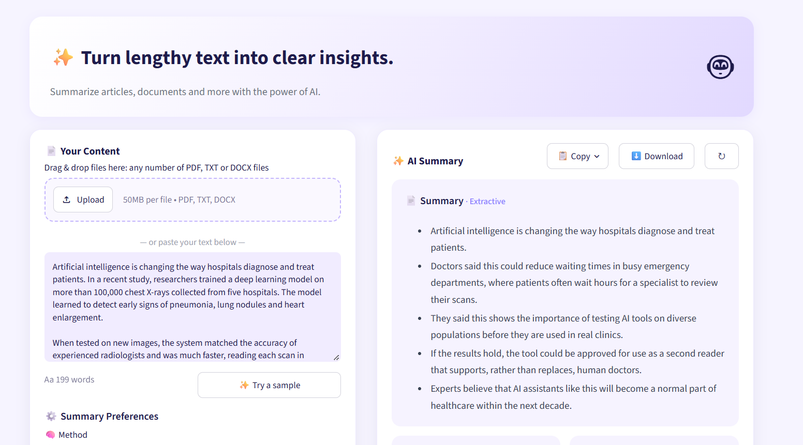
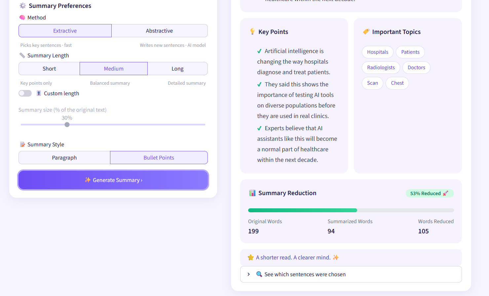
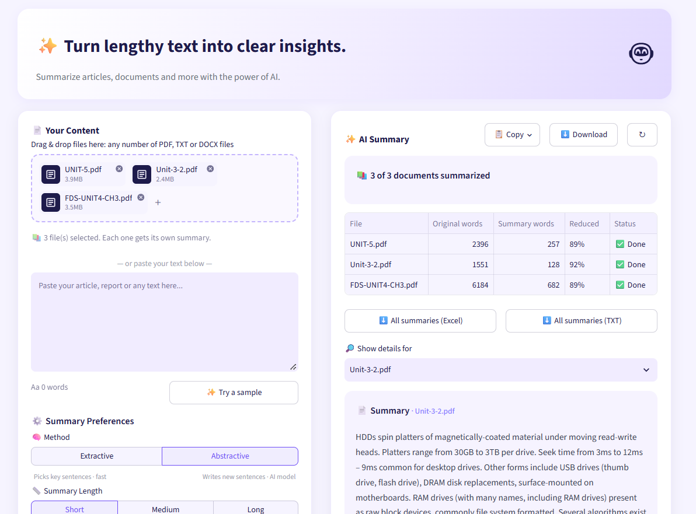
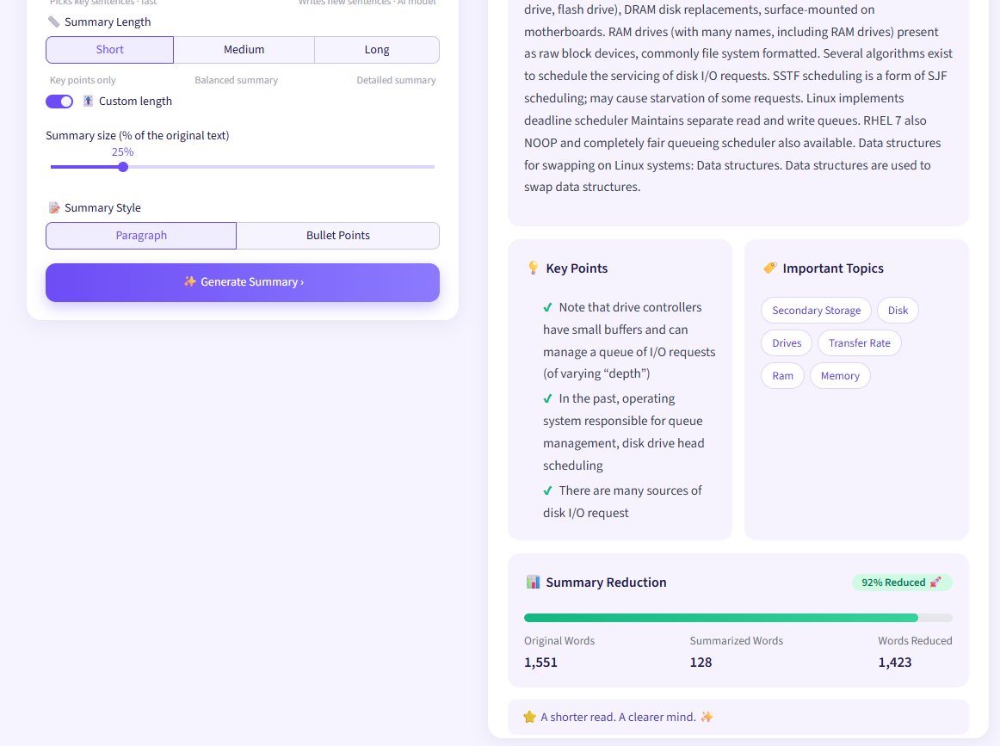

# ✨ Text Summarization System

Turn long articles, reports, lecture notes and transcripts into short, clear summaries.
Upload any number of **PDF, DOCX or TXT** files (or paste text) and get a summary, key points and topics for each one.

**Live demo:** _add your Streamlit link here_



| Key points, topics and reduction | Many files at once |
|---|---|
|  |  |

| Details for one uploaded file (lecture slides, Abstractive) |
|---|
|  |

## Features

- **Two summarization methods**
  - **Extractive:** TextRank on MiniLM sentence embeddings picks the most important sentences
  - **Abstractive:** DistilBART (a Transformer fine-tuned on CNN/DailyMail) writes a new summary
- **Any number of files** at once, with an overview table and a progress bar
- **Short / Medium / Long** or a custom length, as a **paragraph or bullet points**
- **Key points** and **important topics** (KeyBERT-style keyword extraction)
- **Smart PDF cleaning:** removes cover pages, tables of contents, captions, slide bullets and duplicates; OCR for scanned PDFs
- **Downloads:** one summary, or all of them as an **Excel** workbook or a formatted **TXT** report
- **Fast:** models load once, results are cached, and abstractive summaries are generated in batches

## How it works

```
PDF / DOCX / TXT / pasted text
        │
        ▼
1. Clean          text_cleaning.py   read the file, remove page numbers, TOC, bullets, broken lines
2. Tokenize       preprocessing.py   NLTK sentences + noise filter + duplicate removal
        │
        ├─────────────────────────────┐
        ▼                             ▼
3a. Extractive  extractive.py    3b. Abstractive  abstractive.py
    MiniLM embeddings                split into ≤900-token chunks
    similarity matrix + PageRank     DistilBART summarizes each chunk
    top sentences in order           join (re-summarize if too long)
        │                             │
        └──────────────┬──────────────┘
                       ▼
4. Key points + topics + stats  →  Streamlit app  →  Excel / TXT export
```

## Results

Evaluated on 30 CNN/DailyMail test articles (CPU) with `evaluate.py`. All scores are 0–100.

- **Accuracy: ROUGE F1** measures word overlap with the human-written summary.
- **Coherence** measures how smoothly the summary flows: the average similarity between each pair of neighbouring sentences (MiniLM embeddings).

| Method | ROUGE-1 | ROUGE-2 | ROUGE-L | Coherence | Seconds / article |
|---|---|---|---|---|---|
| Lead-3 baseline | 29.30 | 11.26 | 20.11 | 33.40 | 0.01 |
| Extractive (TextRank) | 27.20 | 8.56 | 17.98 | **48.99** | 0.56 |
| Abstractive (DistilBART) | **32.67** | **11.93** | **23.40** | 27.27 | 22.01 |
| Human-written summary | – | – | – | 30.65 | – |

- **Abstractive is the most accurate,** because DistilBART was fine-tuned on news. Its coherence (27.3) is close to the human summaries (30.7), so it flows about as naturally as a person's summary.
- **Extractive has the highest coherence,** because PageRank favours sentences that are similar to each other, so the chosen sentences stay on one topic. Very high similarity can also mean some repetition, so coherence is best read alongside ROUGE.
- **Extractive is about 40× faster,** needs no training and never invents facts, which makes it the better choice for technical documents and large batches.

## Project structure

```
app.py                  Streamlit web app
evaluate.py             Accuracy (ROUGE) and coherence evaluation on CNN/DailyMail
assets/                 App styling, sample text and screenshots
results/                Saved evaluation scores
summarizer/
  pipeline.py           Full pipeline for one document
  text_cleaning.py      PDF / DOCX reading and cleaning
  preprocessing.py      Sentence tokenization and noise filter
  extractive.py         TextRank summarizer
  abstractive.py        DistilBART summarizer
  keywords.py           Important topics
  export.py             Excel and TXT downloads
  evaluation.py         ROUGE and coherence scores
tests/                  Unit tests
```

## Run locally

```bash
git clone https://github.com/<your-username>/Text-Summarization-System.git
cd Text-Summarization-System
python -m venv .venv
.venv\Scripts\activate          # macOS / Linux: source .venv/bin/activate
pip install -r requirements.txt
streamlit run app.py
```

The first run downloads the models (MiniLM ~80 MB, DistilBART ~1.2 GB).

For evaluation and tests:

```bash
pip install -r requirements-dev.txt
python evaluate.py --samples 50
python -m pytest -q
```

## Tech stack

Python · Streamlit · Hugging Face Transformers · Sentence-Transformers · PyTorch · NLTK · scikit-learn · pypdf · RapidOCR · ROUGE

## License

MIT
